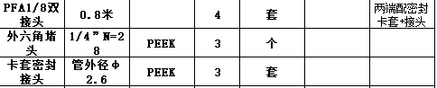

# 连接件与配件登记

本表用于逐件登记 Heat 项目连接件与配件。用户提供的规格、厂家资料和现场适配结果分别记录；未提供的信息标为“待确认”，登记不等于实物适配验收。

2026-11-13状态校正：用户已于2026-11-09确认耐高温阀更换；下方ACC-007“后续更换”描述保留采购登记时点，不表示当前尚未安装。2026-11-13用户确认ACC-007选定材质为PP（聚丙烯）；实物密封适配仍待确认；电源型号按用户要求不记录，详见[设备资料索引](../README.md)。

## 配件清单

| 编号 | 名称 | 连接规格（按用户提供） | 需求数量 | 已有数量 | 待购数量 | 登记状态 |
| --- | --- | --- | --- | --- | --- | --- |
| ACC-001 | 软管—硬管转接头（卡套转宝塔） | φ1/8 卡套（PTFE 聚四氟乙烯硬管）—φ3 mm 宝塔（氟橡胶软管） | 待确认 | 待确认 | 待确认 | 已登记描述，尺寸含义及实物规格待确认 |
| [ACC-002](../microwave/microwave_bottle_fittings.md) | M6 压塞与倒锥压环套件 | PEEK 聚醚醚酮压塞＋ETFE 乙烯—四氟乙烯共聚物压环；适配外径 2.0 mm 硬管 | 待确认 | 待确认 | 待确认 | 候选待核对；报告未给出对应管路接口详图 |
| ACC-003 | 注射泵 PTFE 管，008T32-150-10 | 聚四氟乙烯；外径 3.2 mm（1/8″），内径 1.5 mm（0.059″），按用户提供的产品标法 | 1 m | 待确认 | 待确认 | 已按用户提供规格登记 |
| ACC-004 | 注射泵锁紧锥（倒锥），008CZ32 | ETFE 乙烯—四氟乙烯共聚物；适配外径 3.2 mm（1/8″）PTFE 管，与 2244G 配套 | 1 个 | 待确认 | 待确认 | 已按用户提供规格及配套关系登记 |
| ACC-005 | 注射泵管接头，2244G | PEEK 聚醚醚酮；1/4-28 外螺纹，适配外径 1/8″（3.2 mm）PTFE 管，与 008CZ32 配套 | 1 个 | 待确认 | 待确认 | 已按用户提供规格及配套关系登记 |
| ACC-006 | 蠕动泵氟橡胶软管 | 内径 1/16″（1.5875 mm），外径 1/8″（3.175 mm） | 不登记长度 | 不登记长度 | 不登记长度 | 已按用户提供规格登记；具体牌号待确认 |
| ACC-007 | 后续更换的新电磁阀用塑料倒锥接头 | 用户选定 1/4-28 UNF 螺纹、插管 3.2 mm；材质PP（聚丙烯，2026-11-13用户确认） | 待确认 | 待确认 | 待确认 | 已关联 Henyon HY100T3MP12-62 说明书，标称螺纹一致；PP选材已确认，实物适配待确认 |
| ACC-009 | 微波仪外六角堵头 | PEEK 聚醚醚酮；原图 `1/4″ N=28`，按 1/4 英寸、每英寸 28 牙记录 | 待确认（原图数量 3 个） | 待确认 | 待确认 | 已登记截图；螺纹标准及安装位置待确认 |
| ACC-010 | 微波仪卡套密封接头 | PEEK 聚醚醚酮；原图“管外径 φ2.6”，单位及接口螺纹待确认 | 待确认（原图数量 3 套） | 待确认 | 待确认 | 已登记截图；配套范围及安装位置待确认 |

## ACC-001：软管—硬管转接头（卡套转宝塔）

| 字段 | 登记内容 |
| --- | --- |
| 登记日期 | 2026-11-04 |
| 信息来源 | 用户在项目资料登记对话中提供；尚未提供商品链接、型号或实物照片 |
| 用户原始描述 | 软管硬管转接头：φ1/8卡套（PTFE硬管）-φ3mm（氟橡胶软管）宝塔 |
| 硬管端 | 卡套连接；用户标注 φ1/8，单位及是否指适配硬管外径待确认 |
| 硬管材料 | PTFE：聚四氟乙烯（polytetrafluoroethylene） |
| 软管端 | 宝塔连接（倒刺式管接头）；用户标注 φ3 mm，是否指适配软管内径或宝塔外径待确认 |
| 软管材料 | 氟橡胶；具体类型及牌号待确认，暂不指定为 FKM、FPM 或 FFKM |
| 接头本体、卡套及密封材料 | 待确认；所连接管材的材料不能作为接头本体材料 |
| 厂家及型号 | 待确认 |
| 安装位置 | 待确认：连接设备、端口或液路段 |
| 配套范围 | 待确认：是否包含卡套、螺母及其他密封件 |
| 温度、压力及介质适用范围 | 待厂家资料及实验室确认 |
| 实物适配结果 | 待现场确认 |

尺寸说明：若 φ1/8 指硬管外径 1/8 英寸，则换算为 3.175 mm；此处仅说明单位换算，尚未确认该配件采用此规格。φ3 mm 宝塔标注不能直接作为软管内径或宝塔实测外径。

### 待补确认

1. 卡套端是否适配外径 1/8 英寸（3.175 mm）的 PTFE 硬管；硬管内径是多少。
2. 宝塔端 φ3 mm 的尺寸含义，以及配套氟橡胶软管的内径、外径。
3. 接头材质、厂家型号、配套件、安装位置，以及需求/已有/待购数量。

## ACC-003～ACC-005：注射泵管路配套件

登记日期：2026-11-04。来源为用户在项目资料登记对话中提供的型号、规格、数量及配套关系，尚未提供厂家资料或商品链接。用户给出的数量暂列为本次需求数量，已有及待购数量另行核对；未将其推定为每台泵的用量。

- 管材 008T32-150-10：PTFE，聚四氟乙烯（polytetrafluoroethylene）；长度 1 m，OD 为外径，ID 为内径。
- 锁紧锥 008CZ32：1 个，材质为 ETFE，乙烯—四氟乙烯共聚物（ethylene-tetrafluoroethylene copolymer），由用户补充确认；用于外径 3.2 mm（1/8″）PTFE 管。
- 管接头 2244G：1 个，PEEK，聚醚醚酮（polyetheretherketone）；1/4-28 外螺纹，其中 28 表示每英寸 28 牙；与 008CZ32 锁紧锥配合使用。
- 配套关系：008T32-150-10 管材＋008CZ32 锁紧锥＋2244G 管接头。具体连接哪台注射泵、哪个端口及另一端配件待确认。

保留用户给出的产品规格“3.2 mm（1/8″）”和“1.5 mm（0.059″）”；精确单位换算分别为 1/8″＝3.175 mm、0.059″＝1.4986 mm，产品标称值与换算值分别记录，不据此推定制造公差。

## ACC-006：蠕动泵氟橡胶软管

登记日期：2026-11-04。来源为用户在项目资料登记对话中提供的材料和尺寸。

| 字段 | 登记内容 |
| --- | --- |
| 材料 | 氟橡胶；具体类型、牌号及厂家型号待确认，不直接指定为 FKM、FPM 或 FFKM |
| 内径 | 1/16″，精确换算为 1.5875 mm，约 1.59 mm |
| 外径 | 1/8″，精确换算为 3.175 mm，约 3.18 mm |
| 理论壁厚 | (3.175−1.5875)/2＝0.79375 mm，约 0.794 mm；由标称尺寸计算，非实测值 |
| 长度 | 按用户要求不登记；需求、已有及待购长度均不列为待确认项 |
| 安装位置 | 蠕动泵配件；具体通道及用于泵头受压段还是外接管段待确认 |
| 资料及适配状态 | 未提供厂家规格书、温度/压力范围或现场适配结果 |

既有设备资料记录的 `pump1` HMI 管型为 `1.52 × 0.86`；本条记录的是新提供的软管规格，尚未确认与该管型的对应关系，不据此更新泵管配置或标定数据。

## ACC-007：后续更换的新电磁阀用塑料倒锥接头

登记日期：2026-11-04。用户明确说明该商品用于后续更换的新电磁阀；不据此认定为当前 Bürkert 0127 阀门的配件，也不表示已完成阀门更换。

| 字段 | 登记内容 |
| --- | --- |
| 商品名称 | PP/PVDF塑料接头 卡套 倒锥接头 耐腐蚀 |
| 店铺 | 恒扬流体控制阀制造厂家（商品页显示） |
| 商品链接 | [淘宝商品页，商品 ID 630729660662](https://item.taobao.com/item.htm?id=630729660662) |
| 用户提供的分享链接 | [淘宝分享链接](https://e.tb.cn/h.j6I0MDEyJDjnndE?tk=ULO56b4DV5L) |
| 材料名称 | 用户于2026-11-13确认选定PP：聚丙烯（polypropylene）。商品标题中的PVDF为另一选项；独立压环如有不同材质，不能由该选项推定 |
| 页面列出的螺纹选项 | 1/4-28 UNF、M6；M6 螺距未在可见选项中标注 |
| 页面列出的插管规格 | 两类螺纹均有 3.2 mm、3 mm、2 mm、1.6 mm 四种选项；页面用词为“插管”，尺寸定义及公差待厂家资料确认 |
| 用户选定规格 | 用户于 2026-11-04 明确选定：1/4-28 UNF 螺纹、插管 3.2 mm；2026-11-13用户确认材质为PP（聚丙烯） |
| 对应设备 | 用户提供的后续更换阀门说明书：Henyon 恒扬 HY100T3MP12-62，厂家温州恒扬流体技术有限公司；说明书连接口径 1/4-28 UNF，实物铭牌及安装状态待核对 |
| 配套范围、数量及适用工况 | 待确认；尚未确认是否包含独立压环、具体数量及额定温度/压力 |

来源核对：本次打开分享链接并核对了商品标题、店铺及上述八个规格选项。页面同时提示访问异常、详情待恢复，因此不将未读取到的详情参数补为已确认。商品标题中的“耐腐蚀”不作为具体介质兼容性或额定工况的证明。

阀门依据：[Henyon 两位三通电磁阀说明书](../valve/3758240252Henyon%E4%B8%A4%E4%BD%8D%E4%B8%89%E9%80%9A%E7%94%B5%E7%A3%81%E9%98%80%E4%BD%BF%E7%94%A8%E8%AF%B4%E6%98%8E%E4%B9%A6.pdf)，第 1 页列明 1/4-28 UNF 连接口径，与所选接头的标称螺纹一致；2 mm 为阀有效通径，不是插管外径。该说明书未给出接头密封座详图，不据此确认完整配套。阀体 PTFE 材料不能作为本接头或压环的材质，阀的 0–150℃介质范围也不能替代接头额定温度。说明书主要参数及原件校验信息见 [设备资料索引](../README.md)。

## ACC-009～ACC-010：微波反应仪配件截图登记

登记日期：2026-11-05。用户明确说明为微波反应仪配件，来源为[用户提供的配件表截图](../microwave/images/microwave-accessories-list-20261105.png)。原图未含表头、厂家、型号或完整尺寸说明；数量按图记录，不推定为待购量、已收货量或新增需求量。

按用户要求，仅登记原图第二、三项；第一项不纳入登记及待确认清单。保留原始截图作为来源，现有配件编号不变。

| 编号 | 原图名称 | 原图规格 | 原图材质栏 | 原图数量 | 原图备注 |
| --- | --- | --- | --- | --- | --- |
| ACC-009 | 外六角堵头 | `1/4″ N=28`（28 在图中换行） | PEEK | 3 个 | 空白 |
| ACC-010 | 卡套密封接头 | 管外径 φ2.6 | PEEK | 3 套 | 空白 |

- PEEK：聚醚醚酮。外六角堵头与卡套密封接头的材质栏均标注 PEEK；各套件内密封件的材料及组成仍需完整清单确认。
- 外六角堵头的 `1/4″ N=28` 可按公称直径 1/4 英寸、每英寸 28 牙理解；原图未标明 UNF/UN 等完整标准、螺纹公差或密封形式，不直接归并为 2244G 接头或 ACC-007。
- 卡套密封接头的 φ2.6 明确对应管外径，但截图没有单位声明，需核对是否为 mm；该项未标接头螺纹，不能据此确认微波瓶接口为 M6 或 1/4-28。
- 这份清单与此前 ACC-002 的 M6、2.0 mm 商品图不同，暂分别保留。各项对应顶部加料口、底部排液口或其他位置尚未说明，不推定整套配件已经适配，也不将截图数量与此前候选数量相加。

## 资料保存

后续商品规格、厂家资料或照片按配件编号关联，并注明来源与日期。确认后的信息更新对应条目；实物适配及验收结论须有现场依据。
