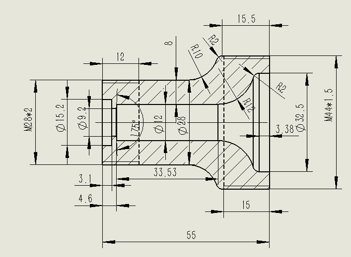
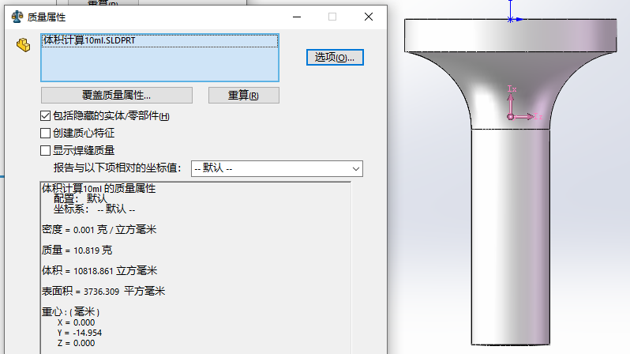

# 微波反应瓶与候选压塞压环参数核对

登记日期：2026-11-04。候选配件编号：ACC-002，M6 外螺纹压塞与倒锥压环套件，适配外径 2.0 mm 硬管。采购数量、厂家及型号待确认。

## 来源与结论

- 瓶体依据：[出厂检验报告](20260624-%E5%87%BA%E5%8E%82%E6%A3%80%E9%AA%8C%E6%8A%A5%E5%91%8A%284%29.doc)附件05的瓶体剖面图、容积计算截图，以及附件06–07的拆装与接口照片。报告型号为 MKM-AH1E，设备序列编号为 MKW-202605021。
- 候选配件依据：用户提供的[商品截图原件](../accessories/images/ACC-002-supplier.png)，未提供商品链接或厂家规格书。
- 本次从原始 DOC 的复合文档数据流提取内嵌图片并查看；下列图纸是原报告图片的提取副本，不是重新绘制的加工图。

报告瓶体图标注 M28×2 和 M44×1.5，未标注加料口或排液口的 M6 螺纹、密封座尺寸或适配管径。仅凭这份报告不能确认 ACC-002 与瓶盖接口适配，状态为“候选待核对”。瓶体端部螺纹与管路接头螺纹应分别核对。

## 报告中的 PTFE 瓶体

PTFE 为聚四氟乙烯（polytetrafluoroethylene）。下表线性尺寸按图纸机械尺寸惯例记为 mm；原截图未附完整图框、单位声明、公差及版本信息，采购加工前应索取完整图纸。

| 项目 | 图纸或报告信息 |
| --- | --- |
| 标称容积 | 10 mL；报告描述适合 3–5 mL 液体反应 |
| 三维模型内腔体积 | 10818.861 mm³，换算约 10.819 mL；为模型计算值，不是实测容量 |
| 瓶体总长 | 55 |
| 直筒段外径 | φ28 |
| 直筒段内径 | φ12 |
| 直筒段壁厚 | 图示 8；与 (28−12)/2 一致，不代表端部及螺纹处最小壁厚 |
| 图左侧端部螺纹 | M28×2：公称直径 28 mm，螺距 2 mm |
| 图右侧端部螺纹 | M44×1.5：公称直径 44 mm，螺距 1.5 mm |
| 左端内部直径标注 | φ15.2、φ9.2 |
| 左端锥面角度标注 | 75°；此为瓶体图内标注，不能作为候选压环锥角 |
| 右端内部直径标注 | φ32.5 |
| 圆角标注 | R10、R12、两处 R2；位置以原图箭头为准 |
| 其他轴向尺寸 | 12、33.53、15.5、15、3.1、4.6、3.38；基准和终点见原图，不等同于各接口有效旋合深度 |
| 工艺接口数量 | 报告附件07描述顶部加料口 3 个（A、B、溶剂），底部排液口 1 个；未给出这些接口的螺纹及密封座详图 |
| 额定工作压力 | 本次瓶体图和对应说明未给出可用于选型的压力额定值或温度—压力关系 |

报告称“常压微量反应系统”并使用“密闭聚四氟乙烯耐压瓶”名称；“耐压瓶”名称、壁厚和螺纹尺寸不能据以确定允许工作压力。报告中设备温度描述也不能直接作为压塞、压环或瓶体组合的额定温度。

## ACC-002 商品图参数

| 部件/参数 | 商品图标注 |
| --- | --- |
| 套件名称 | M6 PEEK 接头＋ETFE 压环 2.0 |
| 适配硬管 | **外径 2.0 mm**；硬管材质及内径未标注 |
| 压塞材料 | PEEK：聚醚醚酮（polyetheretherketone） |
| 压塞螺纹 | M6 外螺纹；螺距、公差等级未标注，不能直接补写为 M6×1 |
| 压塞头部外径 | φ8.78 mm |
| 压塞总长 | 16.16 mm |
| 压塞图示下部轴向长度 | 10.15 mm；不能代替装配所需有效旋合长度 |
| 倒锥压环材料 | ETFE：乙烯—四氟乙烯共聚物（ethylene-tetrafluoroethylene copolymer） |
| 压环图示孔径 | φ2.03 mm |
| 压环最大外径 | φ4.80 mm |
| 压环高度 | 4.80 mm |
| 压环锥角、完整截面及公差 | 未标注 |
| 额定温度、压力及适用介质 | 未标注，须取得该产品的厂家数据 |

商品截图中的 ETFE 压环不是 PTFE 压环，二者材料名称不能互换。该 2.0 mm 套件不能作为外径 1/8 英寸（3.175 mm）硬管的对应规格；ACC-001 的 φ1/8 单位及含义仍保留待确认。

## 采购前需厂家补充的接口信息

1. 确认拟连接的是顶部哪个加料口或底部排液口，并提供对应瓶盖接口剖面图。
2. 给出接口内螺纹完整规格（含螺距）、有效螺纹深度、密封座结构/锥角/深度及过管孔径。
3. 确认实际硬管外径为 2.0 mm 还是 1/8 英寸；对应选择压塞孔径及压环规格。
4. 厂家确认该压塞和压环与接口配套，并提供适用温度、压力、介质及安装要求。

当前登记仅记录候选商品参数，尚未确认适配、采购或现场验收。

## 2026-11-05 补充配件清单

用户另提供微波仪配件表，按用户要求仅保留第二、三项，已在[配件登记表](../accessories/README.md)登记为 ACC-009～ACC-010：PEEK 外六角堵头 3 个、PEEK 卡套密封接头 3 套。对应原图规格为 `1/4″ N=28` 和“管外径 φ2.6”。该表未提供卡套接头螺纹或各项安装位置，不能据此确认本页 M6、2.0 mm 候选套件适配；原始截图和待补参数见登记表。
